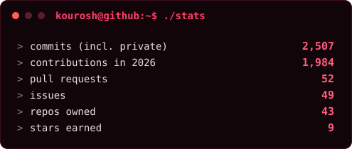
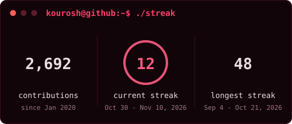
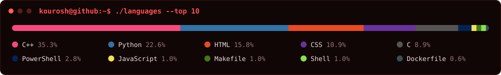

## `$ whoami`

I build things that run. Not mockups, not pitch decks, not "an MVP coming soon". Software that takes real traffic and real users and keeps going when they do something weird.

I started out writing games in C++ because I needed to know how a pixel ends up on a screen. That itch never went away. I want to understand the whole machine, from the socket up to the button, so these days I build the whole machine: backend, frontend, the queue in between, the server it lives on, and the 3am fix when it falls over. The 3am fix is also me.

With my brother I run **Dokkodo Studio**. People come to us when they want a platform built properly the first time. A lot of it is bilingual Persian/English, which means I've fought every RTL bug you can think of and won.

## `$ cat stack.txt`

## `$ ./stats`

Drawn by my own script every night. No third-party stats server, so it doesn't go down.

